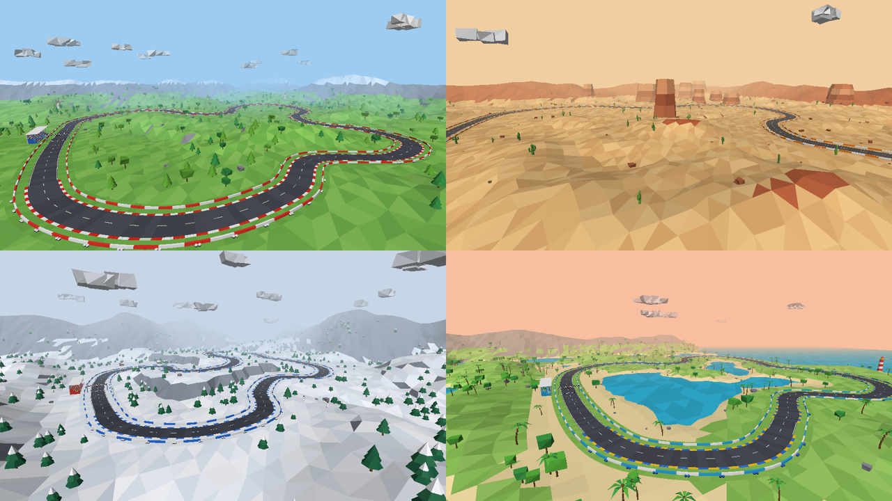

# CARS

Závodní hra v Unity (2021.3): hráč proti počítači na okruhu s checkpointy, měřením časů kol a tabulkou nejlepších časů.

## Ovládání

| Klávesa | Akce |
|---|---|
| W / ↑ | plyn |
| S / ↓ | brzda, po zastavení couvání |
| A D / ← → | zatáčení |
| Mezerník | ruční brzda |
| R | návrat na trať k poslednímu checkpointu |
| C | přepnutí kamery (shora / za autem) |
| Esc / P | pauza (v pauze je tabulka nejlepších časů) |

## Jak to funguje

- **Checkpointy** jsou potomci objektu `Checkpoints` pojmenovaní `1`, `2`, … (`1` je start/cíl).
  Kolo se započítá jen při průjezdu všemi checkpointy popořadě.
- `CarController` – společná fyzika auta (pohon, brzdy, omezovač rychlosti, přítlak, stabilizátory).
  `Car` ji ovládá z klávesnice, `AICar` dostává vstupy od `AIPlayer`.
- `RacerBase` – společná logika závodníka (kola, časy, respawn). Dědí z ní `Player` a `AIPlayer`.
- `UIController` – HUD, odpočet 3-2-1-GO, rychloměr, pořadí a hláška o nejlepším kole.
- `Leaderboard` – 5 nejlepších časů, ukládané do `PlayerPrefs`.

Většinu parametrů (rychlost a obtížnost AI, síla brzd, přítlak…) jde ladit v Inspectoru.

## Low-poly závody (hlavní scéna)

Hra startuje scénou `LowPolyTrack` – titulní menu: **QUICK RACE**, **CHAMPIONSHIP**, **TIME TRIAL**,
**CLASSIC TRACK** (původní trať), **SETTINGS**.

### Ovládání (přemapovatelné v Settings, funguje i gamepad)

| Akce | Klávesnice | Gamepad |
|---|---|---|
| Plyn / brzda | W / S (šipky) | RT / LT (nebo páčka) |
| Zatáčení | A / D | levá páčka |
| Ruční brzda – drift | mezerník | X |
| Nitro | Shift | A |
| Reset na trať | R | Back |
| Kamera | C | Y |
| Pauza | Esc / P | Start |
| Ladicí okno | F1 | – |

### Co hra umí

- **5 tratí**: Green Valley, Desert Canyon, Alpine Pass, Sunset Coast, Neon City (noční městský okruh).
- **Den / noc a sucho / déšť** pro každou trať – v noci svítí lampy a světla aut, v dešti klouže silnice (na sněhu sněží).
- **6 aut** s vlastními vlastnostmi (rychlost, zrychlení, přilnavost, ovladatelnost):
  Sport, Muscle, Hatch, **Pickup** (1 výhra), **Buggy** (3 výhry), **Formula** (vítězství v šampionátu).
  Zlatá a chromová barva se odemknou vítězstvím v šampionátu.
- **Drift a nitro** – smyk na ruční brzdě nabíjí nitro.
- **Kolize** mezi auty, AI předjíždí, vyhýbá se a používá nitro na rovinkách.
- **Šampionát** přes všechny tratě (body 10-6-4-3-2-1), **časovka s ghostem** nejlepšího kola.
- Efekty: stopy smyku, kouř, prach a zpomalení mimo silnici, cákání v dešti, jiskry při nárazu,
  plameny nitra, zorné pole podle rychlosti, třesení kamery, pískání pneumatik.
- Gradientová obloha, stíny mraků, vlnící se voda a stromy, vlastní postprocessing (bloom, barvy, vinětace).
- **Procedurální hudba a zvuky** (generované kódem, bez licencí).
- Náhled tratě v editoru: menu **CARS → Low Poly → Preview …** (do scény se neukládá).

### Struktura kódu

- `Core/` – `GameInput` (klávesy + gamepad), `GameSettings` (hlasitosti, grafika).
- `LowPoly/` – generátor tratí (`TrackGenerator`, `TrackLibrary`, `TrackTheme`), auta (`LowPolyCarFactory`),
  menu a závod (`LowPolyRaceBootstrap` + `.Menu.cs` + `.Race.cs`), `RaceSetup` (volby, šampionát, odemykání).
- `Effects/` – částice, zvuky, ghost, kamera, obloha a počasí, postprocessing, ladicí okno.
- `Shaders/` – obloha, voda, listí, ghost, postprocessing. Když shader nejde, použije se Standard.
- `Editor/` – náhled tratě v editoru.

Novou trať přidáš jedním záznamem v `TrackLibrary.All`.

*(Náhledy jsou vyrenderované mimo Unity ze stejných meshů – bez stínů, světel a postprocessingu.)*
