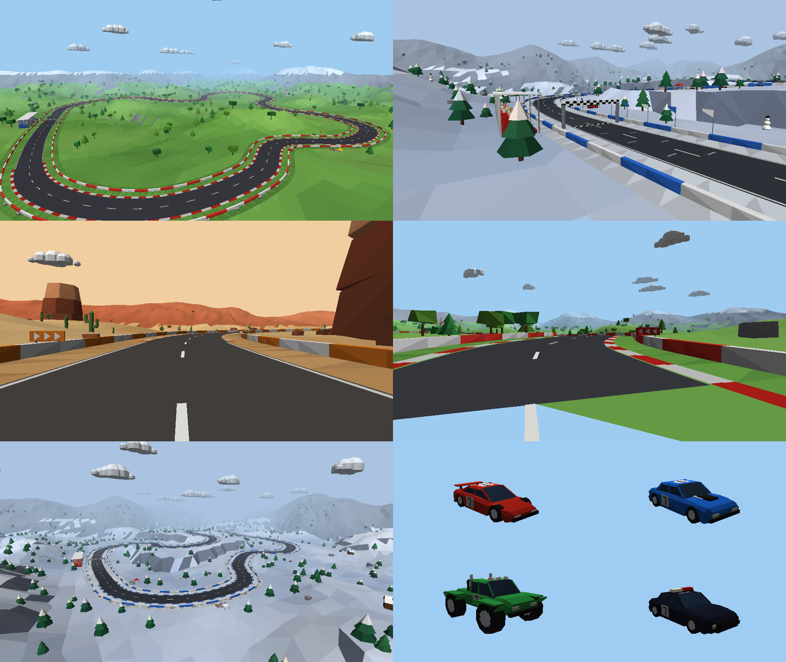
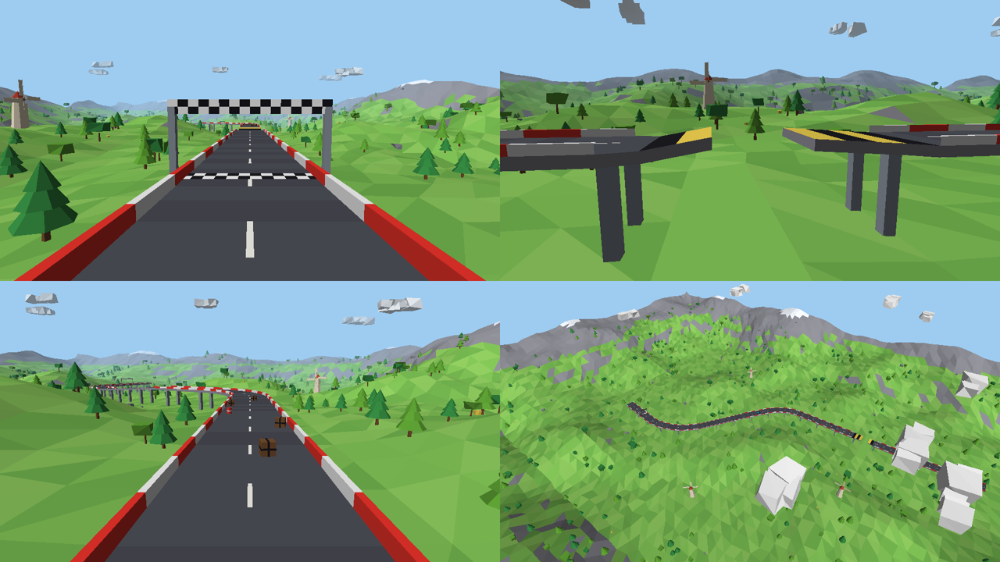
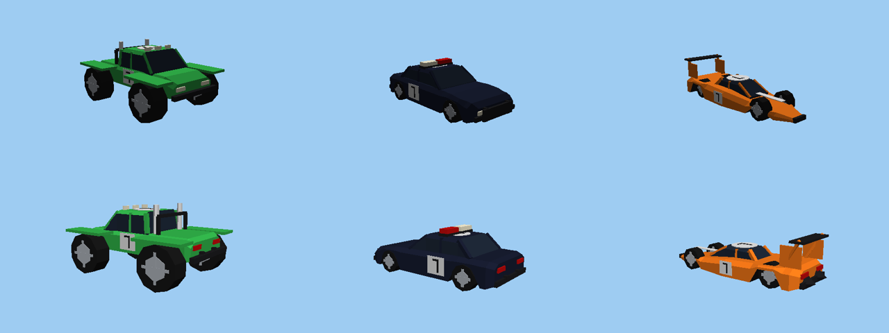
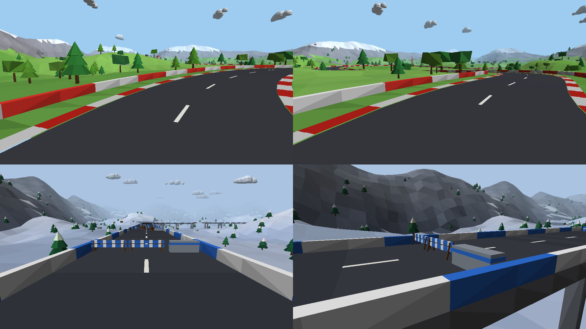
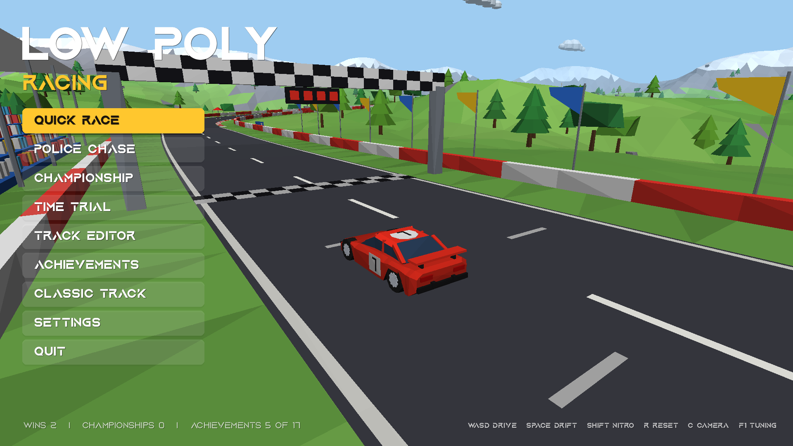
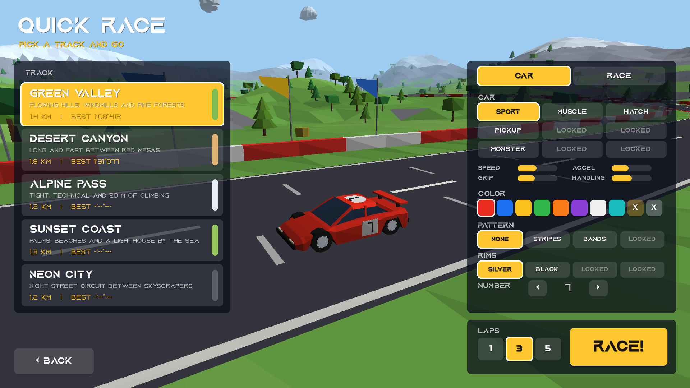
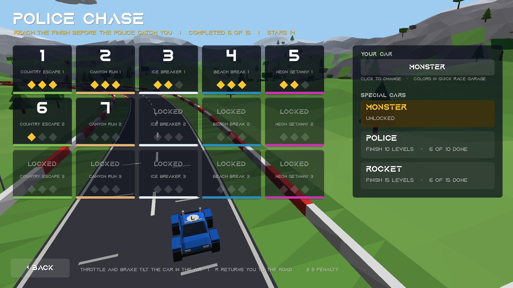
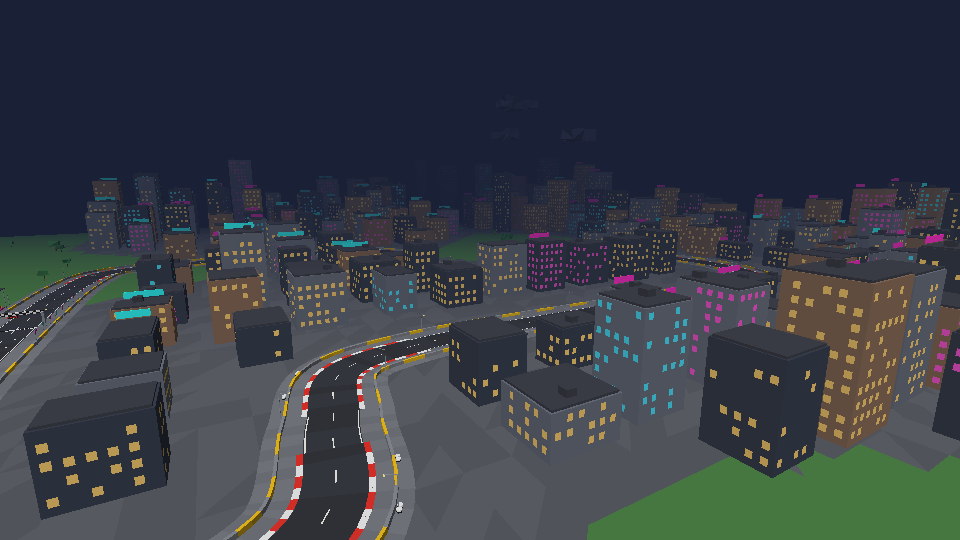

# C.A.R.S – Completely Accurate Racing Simulator

Závodní hra v Unity (2021.3): hráč proti počítači na okruhu s checkpointy, měřením časů kol a tabulkou nejlepších časů.

## Ovládání

| Klávesa | Akce |
|---|---|
| W / ↑ | plyn |
| S / ↓ | brzda, po zastavení couvání |
| A D / ← → | zatáčení |
| Mezerník | ruční brzda |
| R | návrat na trať k poslednímu checkpointu |
| C | přepnutí kamery (shora / za autem) |
| Esc / P | pauza (v pauze je tabulka nejlepších časů) |

## Jak to funguje

- **Checkpointy** jsou potomci objektu `Checkpoints` pojmenovaní `1`, `2`, … (`1` je start/cíl).
  Kolo se započítá jen při průjezdu všemi checkpointy popořadě.
- `CarController` – společná fyzika auta (pohon, brzdy, omezovač rychlosti, přítlak, stabilizátory).
  `Car` ji ovládá z klávesnice, `AICar` dostává vstupy od `AIPlayer`.
- `RacerBase` – společná logika závodníka (kola, časy, respawn). Dědí z ní `Player` a `AIPlayer`.
- `UIController` – HUD, odpočet 3-2-1-GO, rychloměr, pořadí a hláška o nejlepším kole.
- `Leaderboard` – 5 nejlepších časů, ukládané do `PlayerPrefs`.

Většinu parametrů (rychlost a obtížnost AI, síla brzd, přítlak…) jde ladit v Inspectoru.

## Low-poly závody (hlavní scéna)

Hra startuje scénou `LowPolyTrack` – titulní menu: **QUICK RACE**, **CHAMPIONSHIP**, **TIME TRIAL**,
**CLASSIC TRACK** (původní trať), **SETTINGS**.

### Ovládání (přemapovatelné v Settings, funguje i gamepad)

| Akce | Klávesnice | Gamepad |
|---|---|---|
| Plyn / brzda | W / S (šipky) | RT / LT (nebo páčka) |
| Zatáčení | A / D | levá páčka |
| Ruční brzda – drift | mezerník | X |
| Nitro | Shift | A |
| Reset na trať | R | Back |
| Kamera | C | Y |
| Pauza | Esc / P | Start |
| Ladicí okno | F1 | – |

### Co hra umí

- **5 tratí**: Green Valley, Desert Canyon, Alpine Pass, Sunset Coast, Neon City (noční městský okruh).
- **Den / noc a sucho / déšť** pro každou trať – v noci svítí lampy a světla aut, v dešti klouže silnice (na sněhu sněží).
- **6 aut** s vlastními vlastnostmi (rychlost, zrychlení, přilnavost, ovladatelnost):
  Sport, Muscle, Hatch, **Pickup** (1 výhra), **Buggy** (3 výhry), **Formula** (vítězství v šampionátu).
  Zlatá a chromová barva se odemknou vítězstvím v šampionátu.
- **Drift a nitro** – smyk na ruční brzdě nabíjí nitro.
- **Kolize** mezi auty, AI předjíždí, vyhýbá se a používá nitro na rovinkách.
- **Šampionát** přes všechny tratě (body 10-6-4-3-2-1), **časovka s ghostem** nejlepšího kola.
- Efekty: stopy smyku, kouř, prach a zpomalení mimo silnici, cákání v dešti, jiskry při nárazu,
  plameny nitra, zorné pole podle rychlosti, třesení kamery, pískání pneumatik.
- Gradientová obloha, stíny mraků, vlnící se voda a stromy, vlastní postprocessing (bloom, barvy, vinětace).
- **Procedurální hudba a zvuky** (generované kódem, bez licencí).
- Náhled tratě v editoru: menu **CARS → Low Poly → Preview …** (do scény se neukládá).

### Grafika

- **Shader `LowPoly/VertexColor`**: barvy ve vrcholech nesou zapečené stínování (tmavší spodky aut, svodidel,
  budov a kmenů, okraje silnice), plynulé přechody terénu a odstíny stromů. Když shader nejde, hra použije
  Standard a vypadá jako dřív.
- Terén v souvislých plochách podle šumu a výšky (na sněhu namodralé stíny), asfalt bez náhodných pruhů.
- Oblé mraky s jemnou vlastní září, rozmanitější stromy.
- U trati šipky před zatáčkami, reklamní poutače a diváci se stany.
- Zaoblené panely a tlačítka v UI, stín a zvětšení tlačítka při najetí.

### Režim POLICE CHASE

Druhý herní režim (titulní menu → POLICE CHASE): **překážková dráha ze startu do cíle**, vyvýšená nad krajinou
na pilířích, a za tebou jede **policie**. Když se policejní auto udrží těsně u tebe, plní se ukazatel BUSTED.

- **Zátarasy přes celou silnici** ze tří dřevěných zábran – dají se prorazit, ale stojí to rychlost. Od 7. levelu je
  jedna krajní zábrana betonová. **Bedny se při prudkém nárazu rozpadnou** na prkýnka, kužely a sudy odletí.
  Svodidla na vyvýšené dráze zůstávají pevná (proražení by znamenalo pád).
- **15 levelů**, každý se odemkne dokončením předchozího. Prostředí se střídají (louka, poušť, sníh, pobřeží, noční město).
- Na dráze: **skokanky přes mezery** (až 24 m), pole beden a sudů, slalom kuželů, zúžené úseky bez svodidel,
  posuvné zátarasy, **boost pady**. Ve vzduchu se auto samo srovnává, plynem a brzdou nakláníš předek.
- Policie zrychlí, když je daleko, a zblízka najíždí na hráče. Od 6. levelu jedou 2 auta, od 12. levelu 3.
- Spadneš nebo se převrátíš → návrat na poslední bezpečné místo (+3 s). R funguje taky.
- **1–3 hvězdy** podle času, nejlepší časy, replay.
- **Speciální auta**: MONSTER (monster truck) za 5 dokončených levelů, POLICE za 10, ROCKET za všech 15.

Dráhy generuje `ObstacleCourse` (stejný level = vždy stejná dráha), levely a postup jsou v `ChaseLevels`,
policejní AI v `ChaseAI`, hra v `LowPolyRaceBootstrap.Chase.cs`.

### Režim MULTIPLAYER (lokální, split-screen)

Titulní menu → MULTIPLAYER: **2 až 4 hráči na jedné obrazovce**, každý si vybere auto (z odemčených) a barvu.
Dva hráči mají obrazovku nad sebou, tři a čtyři ve čtvrtinách (u tří zbývající čtvrtina ukazuje vedoucí auto shora a mapu).

| Hráč | Klávesnice (plyn, brzda, zatáčení / drift / nitro / reset) | Gamepad |
|---|---|---|
| P1 | W S A D / mezerník / Shift / R (přemapovatelné) | 1 |
| P2 | šipky / pravý Ctrl / pravý Shift / Enter | 2 |
| P3 | I K J L / U / O / H | 3 |
| P4 | numerická 8 5 4 6 / 0 / Enter / tečka | 4 |

- **RACE** – kdo první dojede, vyhrává; ostatní pak mají 30 s na dojetí, jinak DNF.
- **ELIMINATION** – po každém kole vedoucího vypadne poslední auto (hráč pak sleduje vedoucího), vyhrává poslední, kdo zbyde.
- Volitelně 0, 1 nebo 3 auta řízená počítačem, obtížnost, denní doba a počasí.
- **Zápas**: tlačítko REMATCH spustí odvetu a skóre výher (P1 2   P2 1 …) se počítá, dokud se nevrátíte do menu.

Logika (rozložení obrazovky, pravidla vyřazovačky, skóre) je v `Multiplayer`, menu a průběh v `LowPolyRaceBootstrap.Multiplayer.cs`.

### Další funkce

- **Replay** po závodě: TV kamery u trati, kamera za autem, kroužící kamera, zpomalení a zrychlení, přepínání aut.
- **Editor tratí** (titulní menu → TRACK EDITOR): body se klikají a táhnou myší, kolečkem se mění výška,
  trať se průběžně kontroluje (ostré zatáčky, křížení, stoupání). Uložené tratě jsou v seznamu tratí a dá se na nich hned jet.
- **Poškození**: promáčknutí v místě nárazu, odletující úlomky, kouř z motoru, nižší maximální rychlost (vypínatelné).
- **Zničitelná svodidla** (jako v původní hře): na vnější straně ostrých zatáček, od vrcholu kousek za výjezd.
  Prudký náraz díl utrhne a auto projede s většinou rychlosti, slabší nárazy díl jen nakloní (a sčítají se).
  Za svodidly jsou stohy pneumatik, které se dají rozhodit. Utržené díly na silnici se po chvíli propadnou,
  v trávě zůstanou ležet déle – v dalším kole je svodidlo pořád pryč. Na rovinkách zůstávají pevná svodidla.
- **Plynulé podmínky**: DUSK (během závodu se setmí) a CHANGING (začne pršet, silnice zvlhne a klouže).
- **Úspěchy** (17, např. WRECKING CREW za 100 proražených objektů) s oznámením ve hře; některé odemykají **kosmetiku**: vzory laku (pruhy, pásy, šachovnice),
  barvy disků, vlastní startovní číslo.
- **Dotykové ovládání** a ovládání náklonem pro mobil (Android: orientace na šířku, ID `com.lowpoly.cars`).
- **Přístupnost**: asistence řízení a brzdění, velikost UI, vysoký kontrast, návod při prvním závodě.
- **Výkon**: hudba se počítá na pozadí, prostorový index trati (rychlejší stavění terénu), rozsvícených je jen 10 lamp nejblíž kameře.

### Testy a CI

- `Assets/Tests/EditMode` – testy v Unity (Window → General → Test Runner → EditMode).
- `Tools/ci/compile-check.sh` – zkompiluje všechny skripty proti referenčním knihovnám Unity 2021.3 (bez instalace Unity).
- `Tools/ci/logic-tests.sh` – spustí stejné testy bez Unity (přes náhradu Unity API).
- `.github/workflows/ci.yml` – obojí běží na GitHubu při každém pushi. Testy a buildy v Unity (Windows, Android)
  se spustí, až do secrets repozitáře přidáš `UNITY_LICENSE`, `UNITY_EMAIL` a `UNITY_PASSWORD` (viz game.ci).

### Struktura kódu

- `Core/` – `GameInput` (klávesy, gamepad, dotyk), `GameSettings`, `Achievements`, `TrackMarkers` (checkpointy, povrchy).
- `LowPoly/` – generátor tratí (`TrackGenerator`, `TrackLibrary`, `TrackTheme`), auta (`LowPolyCarFactory`),
  menu a závod (`LowPolyRaceBootstrap` + `.Menu.cs` + `.Race.cs`), `RaceSetup` (volby, šampionát, odemykání).
- `Effects/` – částice, zvuky, ghost, replay, poškození, asistence, návod, dotykové ovládání, plynulé podmínky, kamera, obloha a počasí, postprocessing, ladicí okno.
- `Shaders/` – obloha, voda, listí, ghost, postprocessing. Když shader nejde, použije se Standard.
- `Editor/` – náhled tratě v editoru Unity. Kód je rozdělený do assembly `CARS`, `CARS.Editor` a `CARS.Tests`.

Novou trať přidáš jedním záznamem v `TrackLibrary.All`.

*(Náhledy jsou vyrenderované mimo Unity ze stejných meshů – bez stínů, světel a postprocessingu.)*
