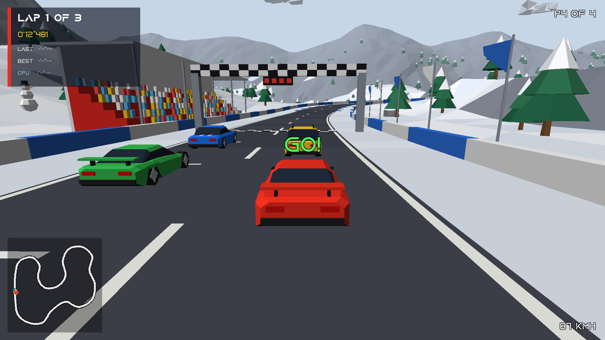

# CARS

Závodní hra v Unity (2021.3): hráč proti počítači na okruhu s checkpointy, měřením časů kol a tabulkou nejlepších časů.

## Ovládání

| Klávesa | Akce |
|---|---|
| W / ↑ | plyn |
| S / ↓ | brzda, po zastavení couvání |
| A D / ← → | zatáčení |
| Mezerník | ruční brzda |
| R | návrat na trať k poslednímu checkpointu |
| C | přepnutí kamery (shora / za autem) |
| Esc / P | pauza (v pauze je tabulka nejlepších časů) |

## Jak to funguje

- **Checkpointy** jsou potomci objektu `Checkpoints` pojmenovaní `1`, `2`, … (`1` je start/cíl).
  Kolo se započítá jen při průjezdu všemi checkpointy popořadě.
- `CarController` – společná fyzika auta (pohon, brzdy, omezovač rychlosti, přítlak, stabilizátory).
  `Car` ji ovládá z klávesnice, `AICar` dostává vstupy od `AIPlayer`.
- `RacerBase` – společná logika závodníka (kola, časy, respawn). Dědí z ní `Player` a `AIPlayer`.
- `UIController` – HUD, odpočet 3-2-1-GO, rychloměr, pořadí a hláška o nejlepším kole.
- `Leaderboard` – 5 nejlepších časů, ukládané do `PlayerPrefs`.

Většinu parametrů (rychlost a obtížnost AI, síla brzd, přítlak…) jde ladit v Inspectoru.

## Low-poly závody

V hlavním menu je tlačítko **LOW POLY**. Otevře startovní obrazovku s živým 3D náhledem, kde si vybereš:

- **trať**: 4 okruhy, každý s vlastním prostředím,
- **auto**: Sport, Muscle nebo Hatch a jednu z 8 barev,
- **soupeře** (1/3/5), **obtížnost** (Easy/Normal/Hard) a **počet kol** (1/3/5).

| Trať | Délka | Prostředí |
|---|---|---|
| GREEN VALLEY | 1,4 km | louky, borovice, větrné mlýny, hory se sněhem |
| DESERT CANYON | 1,8 km | rychlá poušť, kaktusy, červené stolové hory |
| ALPINE PASS | 1,2 km | technická, 20 m převýšení, zasněžené smrky, chaty, sněhuláci |
| SUNSET COAST | 1,3 km | ostrov v moři, laguny, pláže, palmy, maják |

Závod: odpočet, startovní rošt (hráč startuje poslední), minimapa, pořadí, stopy smyku,
„FINAL LAP!“, cíl a výsledková obrazovka (pořadí, celkový čas, nejlepší kolo, rekord tratě).
Každá trať má vlastní tabulku nejlepších kol.

### Jak to funguje

Scéna `LowPolyTrack` obsahuje jen objekt `LowPolyRace` se skriptem `LowPolyRaceBootstrap`, všechno ostatní vzniká kódem:

- `TrackLibrary` – seznam tratí (kontrolní body, téma, šířka, seed). **Novou trať přidáš jedním záznamem.**
- `TrackTheme` – barvy, světlo, mlha, typ krajiny a dekorací (Meadow / Desert / Snow / Coast).
- `TrackGenerator` – silnice, obrubníky, svodidla, startovní brána se semaforem, tribuna s diváky,
  vlajky, pneumatiky v zatáčkách, checkpointy, terén, voda a dekorace.
- `LowPolyCarFactory` – auta včetně fyziky kol; `CarEffects` + `SkidMarks` – stopy smyku.
- `Minimap`, `OrbitCamera`, `LowPolyUI` – minimapa, kamera v menu, stavění UI.
- `RaceSetup` – volby z menu (přežijí restart závodu).

Písmo Aquire nemá znaky `:` a `/`, proto low-poly UI píše časy závodním zápisem `1'05"123`.

*(Náhledy jsou vyrenderované mimo Unity ze stejných meshů a se stejným rozložením UI, ve hře budou mít stíny a lepší osvětlení.)*
