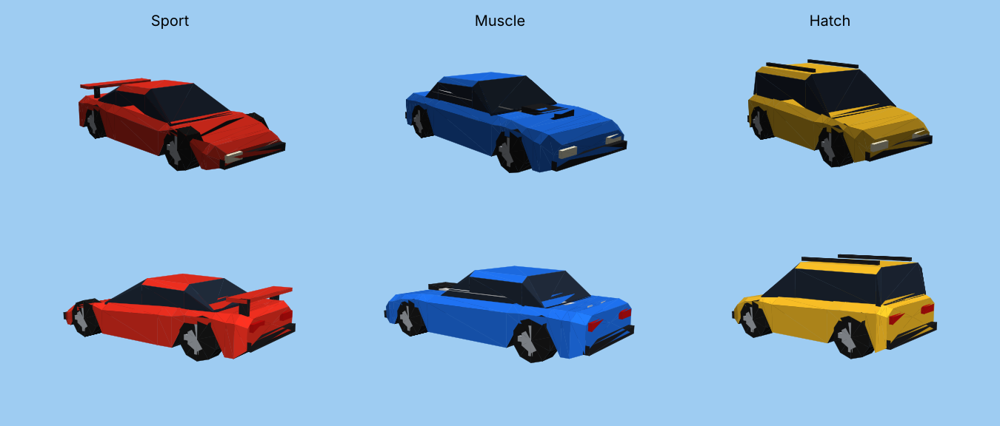
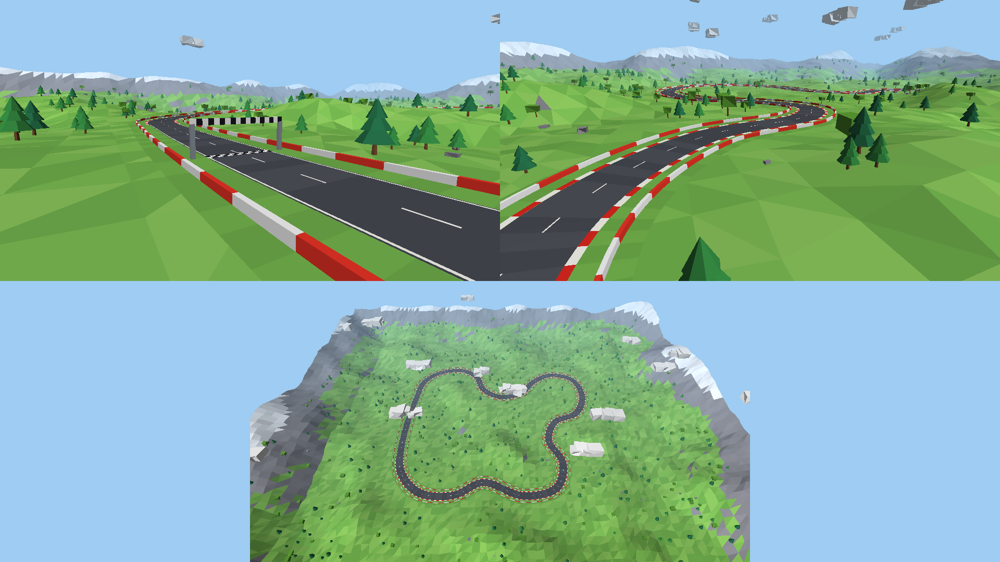

# CARS

Závodní hra v Unity (2021.3): hráč proti počítači na okruhu s checkpointy, měřením časů kol a tabulkou nejlepších časů.

## Ovládání

| Klávesa | Akce |
|---|---|
| W / ↑ | plyn |
| S / ↓ | brzda, po zastavení couvání |
| A D / ← → | zatáčení |
| Mezerník | ruční brzda |
| R | návrat na trať k poslednímu checkpointu |
| C | přepnutí kamery (shora / za autem) |
| Esc / P | pauza (v pauze je tabulka nejlepších časů) |

## Jak to funguje

- **Checkpointy** jsou potomci objektu `Checkpoints` pojmenovaní `1`, `2`, … (`1` je start/cíl).
  Kolo se započítá jen při průjezdu všemi checkpointy popořadě.
- `CarController` – společná fyzika auta (pohon, brzdy, omezovač rychlosti, přítlak, stabilizátory).
  `Car` ji ovládá z klávesnice, `AICar` dostává vstupy od `AIPlayer`.
- `RacerBase` – společná logika závodníka (kola, časy, respawn). Dědí z ní `Player` a `AIPlayer`.
- `UIController` – HUD, odpočet 3-2-1-GO, rychloměr, pořadí a hláška o nejlepším kole.
- `Leaderboard` – 5 nejlepších časů, ukládané do `PlayerPrefs`.

Většinu parametrů (rychlost a obtížnost AI, síla brzd, přítlak…) jde ladit v Inspectoru.

## Low-poly trať

V hlavním menu je tlačítko **LOW POLY**, které spustí scénu `LowPolyTrack`. Celá scéna se postaví
kódem při spuštění (ve scéně je jen objekt `LowPolyRace` se skriptem `LowPolyRaceBootstrap`):

- `TrackGenerator` – okruh (~1,4 km) z hladké křivky přes kontrolní body: asfalt, obrubníky v zatáčkách,
  svodidla, startovní brána, 58 checkpointů, kopcovitý terén s horami, stromy, kameny a mraky.
- `LowPolyCarFactory` – auta ve třech stylech (Sport, Muscle, Hatch) včetně fyziky kol.
- `LowPolyRaceBootstrap` – světlo, mlha, kamery, HUD a pauzovací menu. V Inspectoru jde měnit
  barvy a styl aut, obtížnost AI, tvar trati (`track.controlPoints`), šířku silnice, počet stromů…

*(Náhledy jsou vyrenderované mimo Unity ze stejných meshů – ve hře budou mít stíny a lepší osvětlení.)*
